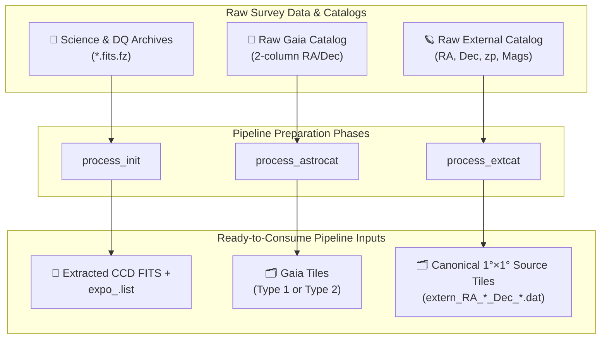

# 🗂️ Data Preparation Guide

[🏠 Home](README.md) · [🛠️ C++ User Guide](CPP_GUIDE.md) · [📋 Parameter Reference](CPP_PIPELINE_PARAMETERS.md) · [🔗 Container Paths](PATHS.md)

Prepare the four input data classes below before launching scientific processing. In native runs, paths are ordinary host filesystem paths; in containerized runs, paths must be mounted and referenced via their container destinations (see [PATHS.md](PATHS.md)).

---

## 📦 Overview of Required Inputs

| Input Class | Purpose | Minimum Requirement |
| :--- | :--- | :--- |
| **Science images** | Primary CCD exposures for source detection, PSF modeling, and shear measurement. | Multi-extension FITS/FZ archives matching configured dataset prefixes and `CCDNUM` keywords. |
| **Gaia catalog** | High-precision sky-coordinate reference for source matching and PU astrometry. | Covers the Science footprint using either the **Type 1** ($10^\circ \times 10^\circ$) or **Type 2** ($1^\circ \times 1^\circ$) tile layout. |
| **External source catalog** | Supplies sky coordinates, photometric redshift (`zp`), and multi-band magnitudes. | Canonical $1^\circ \times 1^\circ$ tiles containing `ra`, `dec`, `zp`, and at least one observed-band magnitude. |
| **DQ masks** *(config-dependent)* | Identifies bad, saturated, cosmic-ray, or defective pixels on each CCD. | **Required** by `cpp_Lite` (fixed per-chip DQ) and by `cpp_Standard` whenever `include_mask != 0`. |

---

## 🔭 Science Images & DQ Masks

### 1. Science FITS/FZ Archives

`process_init` scans `[init].science_root` and `[init].dq_root` for compressed multi-extension FITS archives, extracts individual CCD images identified by their physical `CCDNUM` header keyword (never by HDU index), and writes per-dataset exposure lists.

| Convention | Default Value | Where to Configure | Rebuild Required? |
| :--- | :--- | :--- | :---: |
| **Archive suffix** | `.fits.fz` | `InitConfig::ARCHIVE_SUFFIX` (`Initialize.hpp` in Lite) | Yes |
| **CCD identity keyword** | `CCDNUM` | `InitConfig::CCDNUM_KEYWORD` (`Initialize.hpp` in Lite) | Yes |
| **DQ stem replacement** | `ood` → `ooi` | `DQ_STEM_REPLACE_FROM` / `DQ_STEM_REPLACE_TO` | Yes |
| **Dataset mapping** | `gband:c4d_` | `[init].datasets` (`TARGET:PREFIX` pairs) | No (INI) |
| **Basename token filter** | `v1` | `[init].contains` (case-sensitive OR match; empty `contains =` disables) | No (INI) |

### 2. Data Quality (DQ) Masks

DQ masks flag invalid pixels (saturation, bleed trails, bad columns) so they are excluded from background estimation, source detection, and Fourier power spectra.

- **`cpp_Lite`:** Fixed to per-chip DQ masks (`include_Mask = 2` behavior); DQ archives must always be provided.
- **`cpp_Standard`:** Controlled via `[lensing].include_mask` (`0` = disabled, `1..3` = active mask modes). Verify that both `process_init` and `process_main` agree before omitting DQ inputs.

---

## Gaia Astrometric Catalog

Every Gaia tile consumed by the pipeline must reside directly under `[lensing].astrometry_cat`, begin with **exactly one header line**, and provide numeric `RA` and `Dec` in its first two columns (comma- or whitespace-separated; extra columns are ignored).

| Variant | Supported Gaia Layouts | How to Select Type 2 ($1^\circ \times 1^\circ$) |
| :--- | :--- | :--- |
| **`cpp_Standard`** | **Type 1** ($10^\circ \times 10^\circ$, default) or **Type 2** ($1^\circ \times 1^\circ$) | Set `[lensing].astrometry_cat_type = 2` in `pipeline.ini`. |
| **`cpp_Lite`** | **Type 2** ($1^\circ \times 1^\circ$) only | Fixed to Type 2 automatically (no `astrometry_cat_type` key). |

### Type 1: Legacy Large Tiles ($10^\circ \times 10^\circ$)

- **Mid-latitude (`|Dec| < 80°`):** `gaia_<p|m><D>_<RR>.cat`
  - `p` = non-negative Dec, `m` = negative Dec
  - `D = floor(|Dec| / 10) + 1` (`1` to `8`)
  - `RR = floor(RA / 10)` (`00` to `35`, zero-padded)
- **Polar caps (`|Dec| >= 80°`):** `gaia_<p|m>9.cat` (no RA suffix)

| Example Filename | Sky Coverage |
| :--- | :--- |
| `gaia_p1_00.cat` | `0° <= RA < 10°`, `0° <= Dec < 10°` |
| `gaia_m3_12.cat` | `120° <= RA < 130°`, `-30° < Dec <= -20°` |
| `gaia_p9.cat` | `0° <= RA < 360°`, `80° <= Dec <= 90°` |

> [!NOTE]
> For Type 1, to ensure that stars can still be selected for exposures located at the edges of the $10^\circ \times 10^\circ$ grid, expand the upper and lower Dec coverage limits of a single star catalog by 2°. Expand the upper and lower RA limits by 2°, 4°, and 6° within the 0°, 30°, and 60° ranges, respectively, as in the existing catalog-preparation convention.

### Type 2: Canonical One-Degree Tiles ($1^\circ \times 1^\circ$)

- **Filename Grammar:** `<ASTROMETRY_TILE_PREFIX>RA_<RA0>_<RA1>_Dec_<Dec0>_<Dec1>.dat`
- **Default Prefix:** `astra_` (defined in `config/pathconfig.hpp`, excluding `RA_`)
- **Formatting:** `RA0`/`RA1` are 3-digit integers (`000`–`360`); `Dec0`/`Dec1` use `p`/`m` plus 2-digit integers.
- **Example:** `astra_RA_123_124_Dec_m05_m04.dat` covers `123° <= RA < 124°`, `-5° <= Dec < -4°`.

> [!TIP]
> **Generating Type-2 Tiles (`process_astrocat`):** Point `[astrocat].input_directory` to a flat directory of raw RA/Dec files and set `[astrocat].output_directory`. The tool deduplicates exact/1-ULP coordinates (`0 <= RA <= 360` with `360` stored as `0`, `-90 <= Dec <= 90` with `90` in the final tile) and writes compliant Type-2 tiles with a header line. Set `add_header = true` if raw files have no header, or `false` to skip one input header line.

---

## External Source Catalog

The external source catalog provides sky positions, photometric redshift (`zp`), and multi-band photometry for galaxy matching and Field-Distortion (`process_fd`) binning.

### 1. Minimum Schema Contract

| Field | Description | Notes |
| :--- | :--- | :--- |
| **`ra`** | Right Ascension (degrees) | Used for spatial matching and partitioning. |
| **`dec`** | Declination (degrees) | Used for spatial matching and partitioning. |
| **`zp`** | Photometric redshift | Treated as photo-$z$ by `process_fd` quality cuts (`zplow`..`zphigh`), **not** a magnitude zero point. |
| **Observed-band magnitude** | Magnitude in $\ge 1$ band (`g`, `r`, `i`, `z`, or `y`) | `process_fd` selects the first available band in **`i → z → r → g → y`** priority order. |

### 2. One-Degree Tile Convention (`process_extcat`)

| Property | Specification |
| :--- | :--- |
| **Tile footprint** | $1^\circ \times 1^\circ$ (`RA1 = RA0 + 1`, `Dec1 = Dec0 + 1`) |
| **Filename pattern** | `<SOURCE_CAT_TILE_PREFIX>RA_<RA0>_<RA1>_Dec_<Dec0>_<Dec1>.dat` |
| **Default prefix** | `extern_` (defined in `config/pathconfig.hpp`) |
| **Example** | `extern_RA_123_124_Dec_m05_m04.dat` (`123° <= RA < 124°`, `-5° <= Dec < -4°`) |
| **Header rule** | Exactly one header line precedes data rows |

### 3. Column Mapping & Projection (`[extcat]`)

All column indices in `[extcat]` are **1-based indices into the raw input files** (`0` marks a magnitude band as absent):

- **Pass-Through Mode (`use_explicit_columns = false`):** Expects `total_columns` (default `18`) per row.
- **Explicit Projection (`use_explicit_columns = true`):** Outputs only the columns listed in `input_columns` in that exact order. Must retain `ra`, `dec`, `zp`, and all non-zero magnitude columns.
- **Coordinate Discovery:** Set `use_explicit_coordinate_columns = true` to use `ra_column` and `dec_column` directly instead of header-name discovery.
- **Producer vs. Consumer Paths:** In `cpp_Standard`, `[extcat].output_directory` and `[lensing].source_cat` alias the same runtime setting. In `cpp_Lite`, they are independent fields—set both when consuming newly generated tiles.

---

## 📜 Existing Exposure Lists (Downstream-Only Runs)

When skipping `process_init` (`run_process_init = false`), supply an existing top-level list via `[process].expo_list` (or leave it empty to auto-derive `<output_root>/expo_<target>.list` per dataset):

1. **Top-Level List (`expo_<target>.list`):** One per-exposure chip-list path per line (an optional trailing chip count is accepted; quoted paths are supported).
2. **Per-Exposure Chip List (`<target>/expolists/<exposure>.list`):** One extracted Science CCD FITS path per line.

> [!IMPORTANT]
> `process_main` and `process_rearr` derive the `<target>` dataset root directly from the FITS paths inside the chip lists. Moving files or changing `[init].output_root` alone does not relocate an existing dataset unless the list paths are also updated.

---

## ✅ Pre-Flight Checklist

- [ ] **Archive & Detector Match:** Science and DQ archives share matching exposures and physical `CCDNUM` headers.
- [ ] **Catalog Sky Coverage:** Gaia and external source tiles completely cover the RA/Dec footprint of your exposures.
- [ ] **Layout Consistency:** Standard `astrometry_cat_type` matches your Gaia tile format (`1` or `2`); Lite uses Type 2.
- [ ] **Column Mapping:** 1-based `[extcat]` indices match your raw catalog schema, and at least one magnitude band is non-zero.
- [ ] **Pilot Validation:** Always test on a small sample of exposures and inspect `<exposure>_all.cat` before launching a full survey run.
