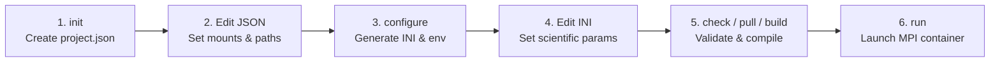

# 🐳 Docker Workstation Guide

[🏠 Home](README.md) · [🛠️ C++ User Guide](CPP_GUIDE.md) · [🔗 Container Paths](PATHS.md) · [🏔️ HPC Apptainer](HPC.md)

Docker provides a prebuilt `linux/amd64` scientific C++ toolchain (`GCC 12.3.0`, `OpenMPI 4.1.8`, `CFITSIO`, `FFTW3`, `Eigen3`, `BLAS/LAPACK`) without requiring local library compilation. The `cpp_docker/fqctl.py` utility uses only the Python 3.8+ standard library (no Docker Compose required).

---

## 🔄 Container Workflow Overview



---

## 1. Initialize and Edit `project.json`

From the repository root, initialize the project configuration file:

```bash
python3 cpp_docker/fqctl.py init
```

Edit `cpp_docker/project.json` to map your host directories into container paths:

| JSON Field | Purpose & Rules |
| :--- | :--- |
| `variant` | `"standard"` or `"lite"` (must match the `source` directory). |
| `source` | Path to the C++ Makefile directory (`../cpp_Standard` or `../cpp_Lite`). |
| `image` | OCI toolchain image reference (pin a tag or `@sha256:...` digest for production). |
| `ranks` | MPI process count for `fqctl.py run` (minimum `2`). |
| `build_jobs` | Parallel compiler jobs (`make -j`) during `fqctl.py build`. |
| `run_directory` | Output directory for generated `pipeline.ini` and `cpppipeline.env` (outside the source tree). |
| `mounts` | List of host-to-container bind mounts (`host`, `container`, `mode`, optional `create`). |
| `paths` | Container-side paths mapped into the managed `[...]` sections of `pipeline.ini`. |
| `environment` | Container environment variables (thread counts default to `1`). |
| `hpc` | Apptainer SIF and Slurm settings used when generating `cpppipeline.env` (see [HPC.md](HPC.md)). |

> [!NOTE]
> Relative host paths in `project.json` are resolved relative to the directory containing `project.json`. See **[Container Paths (PATHS.md)](PATHS.md)** for complete mount rules, shared parent mounts, and every supported `paths` key.

---

## 2. Generate Run Configuration (`configure`)

Generate the container-managed INI and HPC environment files under `run_directory`:

```bash
python3 cpp_docker/fqctl.py configure
```

| Generated File | Edit Policy |
| :--- | :--- |
| `pipeline.ini` | **Managed path block:** Auto-populated from `project.json` (do not edit paths here).<br/>**Scientific settings:** Uncomment and configure phases, datasets, geometry, and cuts outside the managed block. |
| `cpppipeline.env` | Auto-generated snapshot for the [HPC Apptainer runner](HPC.md); always edit `project.json` and re-run `configure` instead of editing this file directly. |

> [!IMPORTANT]
> Only paths declared in `project.json` are active initially; all other INI keys start as commented blanks (`# key =`), inheriting the variant's compiled header defaults (`Standard`: `init`, `main`, `rearr`, `fd`; `Lite`: `init`, `main`). Explicitly configure your active phases and scientific settings in `pipeline.ini` before running. Re-running `configure` updates the managed path block while preserving your scientific edits (and saves a backup of the previous INI).

---

## 3. Validate, Pull Image & Compile

```bash
python3 cpp_docker/fqctl.py check
python3 cpp_docker/fqctl.py pull
python3 cpp_docker/fqctl.py build
```

- **`check`:** Validates `project.json`, explicit INI entries, and declared host mounts offline without starting Docker or MPI.
- **`pull`:** Downloads the configured toolchain image.
- **`build`:** Runs `make clean && make` inside the container against your mounted `source` tree. Re-run `build` only when C++ headers or source files change; INI edits do not require rebuilding.

---

## 4. Run the Pipeline

```bash
python3 cpp_docker/fqctl.py run
```

To use a custom JSON location with any subcommand, pass `--json`:

```bash
python3 cpp_docker/fqctl.py run --json /shared/project/project.json
```

**Execution Guarantees:**
- Launches `mpirun -np <ranks> /workspace/src_pipe/Fourier_Quad_Pipe --config /fq-config/pipeline.ini`.
- Mounts the C++ source tree and generated INI **read-only** (`ro`) during execution.
- Runs under your host `UID:GID` so output files written to `rw` mounts have normal host ownership.

---

## 🔧 Troubleshooting

| Symptom / Message | Resolution |
| :--- | :--- |
| **`project.json` modified** | Run `python3 cpp_docker/fqctl.py configure` followed by `check` (scientific INI edits are preserved). |
| **Mount source missing** | Verify the `host` path exists. Only `rw` directories with `"create": true` are created automatically. |
| **Program reads a legacy site path** | A commented `# key =` inherits compiled defaults; declare the path in `project.json` or uncomment it in `pipeline.ini`. |
| **Permission denied on mounts** | Check host directory permissions, `ro`/`rw` mode in `mounts`, and Docker daemon access. |
| **Missing `Fourier_Quad_Pipe` binary** | Run `python3 cpp_docker/fqctl.py build` for the selected variant. |
| **MPI rank allocation failure** | Reduce `ranks` in `project.json` to match the CPU cores allocated to your Docker engine. |
