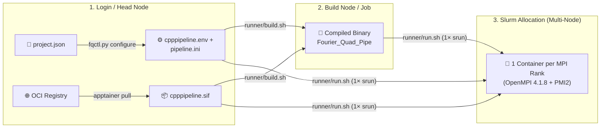

# 🏔️ HPC Runner Guide (Slurm + Apptainer)

[🏠 Home](README.md) · [🛠️ C++ User Guide](CPP_GUIDE.md) · [🐳 Docker Guide](DOCKER.md) · [🔗 Container Paths](PATHS.md)

This guide covers multi-node **Slurm + PMI2** execution on x86_64 HPC clusters using **Apptainer / Singularity** (`--cleanenv --no-eval --no-mount`). For native cluster builds without containers, use the [C++ User Guide](CPP_GUIDE.md).

---

## 🏗️ HPC Container Architecture



---

## 1. Prepare Configuration & SIF Image

### Generate `cpppipeline.env` & `pipeline.ini`

On a login node (requires Python 3.8+ and shared filesystem access; **Docker is not required**), initialize and configure `cpp_docker/project.json` as shown in [DOCKER.md](DOCKER.md#1-initialize-and-edit-projectjson), including the `hpc` block:

| `project.json` Field | Example / Description |
| :--- | :--- |
| `hpc.sif` | `"/shared/images/cpppipeline.sif"` — SIF path readable by all compute nodes. |
| `hpc.runtime` | `"apptainer"`, `"singularity"`, or an absolute executable path. |
| `hpc.srun_args` | Optional Slurm placement flags, e.g., `["--cpu-bind=cores"]`. |
| `hpc.environment` | Extra container environment variables, e.g., `{"OMP_NUM_THREADS": "1"}`. |

Then generate `pipeline.ini` and `cpppipeline.env`:

```bash
python3 cpp_docker/fqctl.py configure
```

*(Ensure the repository, `run_directory`, data directories, and SIF image reside on shared filesystems accessible across all compute nodes.)*

### Pull the Apptainer SIF Image

On a node with network access, pull the toolchain image into your shared storage:

```bash
apptainer pull /shared/images/cpppipeline.sif \
  docker://ghcr.io/syoong-s/fourier_quad_pipeline_neo:gxx12.3-openmpi4.1.8-pmi2
```

---

## 2. Validate & Compile Once

### Offline Configuration Check

Validate explicit INI settings and declared bind mounts before submitting jobs (does not start a container or require a Slurm allocation):

```bash
bash /absolute/repo/cpp_docker/runner/run.sh --check \
  /absolute/run/cpppipeline.env
```

### Single-Task Containerized Build

Compile the selected C++ variant once inside the SIF image (run interactively on a build node or inside a **1-task** Slurm build job):

```bash
bash /absolute/repo/cpp_docker/runner/build.sh /absolute/run/cpppipeline.env
```

> [!CAUTION]
> **Do not prefix `build.sh` with a multi-task `srun`!** Running multiple tasks against `build.sh` causes every task to concurrently run `make clean && make` in the same source tree. Re-run `build.sh` only when C++ headers or source files change.

---

## 3. Launch from Your Slurm Job Script

Request your cluster partition, account, node/task count (at least **2 tasks**), memory, and walltime in your own `#SBATCH` script, then invoke `run.sh` **once**:

```bash
#!/bin/bash
#SBATCH --job-name=fq_pipe
#SBATCH --nodes=2
#SBATCH --ntasks=64
#SBATCH --cpus-per-task=1
#SBATCH --time=04:00:00

# Load site Apptainer module if required (do NOT bind host MPI over container MPI)
# module load apptainer

bash /absolute/repo/cpp_docker/runner/run.sh /absolute/run/cpppipeline.env
```

### Runtime Execution Rules

| Aspect | Behavior & Requirement |
| :--- | :--- |
| **`srun` Invocation** | `run.sh` executes **one internal `srun`** (`--mpi=pmi2`). **Never wrap `run.sh` in an outer `srun`.** |
| **Task Count** | Controlled entirely by your Slurm allocation (`#SBATCH --ntasks`); `project.json`'s `ranks` field is ignored on HPC. |
| **Per-Rank Command** | Each Slurm task enters `runtime.sh` and runs `/workspace/src_pipe/Fourier_Quad_Pipe --config /fq-config/pipeline.ini`. |
| **Configuration Updates** | After editing `project.json`, re-run `python3 cpp_docker/fqctl.py configure` to refresh `cpppipeline.env` and `pipeline.ini` (scientific INI settings outside the managed block are preserved). |
| **Security & Trust** | `cpppipeline.env` is sourced as trusted Bash input generated from your `project.json`; never source unreviewed `.env` files from untrusted users. |
