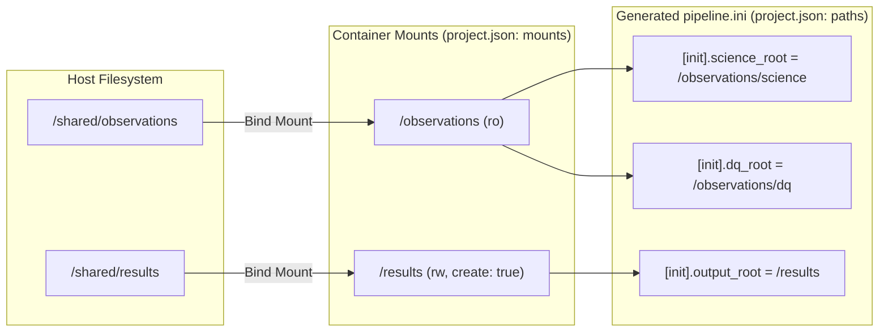

# 🔗 Container Path Reference

[🏠 Home](README.md) · [🐳 Docker Guide](DOCKER.md) · [🏔️ HPC Apptainer](HPC.md) · [📋 Parameter Reference](CPP_PIPELINE_PARAMETERS.md)

The C++ executable (`Fourier_Quad_Pipe`) sees only the filesystem inside its runtime environment. When using [Docker](DOCKER.md) or [HPC Apptainer](HPC.md), `cpp_docker/project.json` bridges host storage and C++ INI configuration through two sections:
- **`mounts`:** Binds host directories/files into container destinations (for both Docker and Apptainer).
- **`paths`:** Writes those container destinations into the managed block of the generated `pipeline.ini`.

*(Native runs do not use `project.json`; place ordinary host paths directly into your `pipeline.ini`.)*

---

## 🗺️ How `mounts` and `paths` Connect



### Shared Parent Mount Example

Mount a common parent directory once and reference multiple subdirectories under it in `paths`:

```json
{
  "mounts": [
    {"host": "/shared/observations", "container": "/observations", "mode": "ro"},
    {"host": "/shared/results", "container": "/results", "mode": "rw", "create": true}
  ],
  "paths": {
    "init.science_root": "/observations/science",
    "init.dq_root": "/observations/dq",
    "init.output_root": "/results"
  }
}
```

### `mounts` Entry Specification

| Field | Rule & Constraints |
| :--- | :--- |
| **`host`** | Host directory or regular file. Relative paths are resolved against the directory containing `project.json`. Must exist unless `mode: "rw"` and `create: true`. |
| **`container`** | Absolute path inside the container. Spaces are supported; colons (`:`), commas (`,`), and newlines are forbidden. System, `/workspace/src_pipe`, and `/fq-config` paths are reserved. |
| **`mode`** | `"ro"` (default, read-only) or `"rw"` (read-write for outputs). |
| **`create`** | Optional boolean (`false` by default). Only `"rw"` directories may be auto-created on the host. |

> [!TIP]
> - When the pipeline needs to create, rename, or overwrite an output file, always mount its **parent directory** as `"rw"`.
> - Explicit parent/child mounts are supported (the deepest matching container path governs visibility and permissions), though duplicate `container` destinations are rejected.

---

## 📋 Complete `paths` Key Reference

Omitting a key or setting it to `null` leaves the corresponding INI entry commented (`# key =`), except where linked producer/consumer aliases apply below. Setting an explicit empty string `""` writes an active empty assignment (`key =`).

| JSON `paths` Key | INI Target | Direction & Mode | Description & Variant Notes |
| :--- | :--- | :---: | :--- |
| `init.science_root` | `[init].science_root` | Input (`ro`) | Science FITS/FZ archive directory. |
| `init.dq_root` | `[init].dq_root` | Input (`ro`) | DQ mask archive directory (required when workflow reads DQ). |
| `init.output_root` | `[init].output_root` | Output (`rw`) | Writable parent root for extracted datasets, lists, stamps, and results. |
| `astrocat.input_directory` | `[astrocat].input_directory` | Input (`ro`) | Flat directory of raw 2-column Gaia files. |
| `astrocat.output_directory` | `[astrocat].output_directory` | Output (`rw`) | Destination for generated $1^\circ \times 1^\circ$ Gaia tiles. |
| `lensing.astrometry_cat` | `[lensing].astrometry_cat` | Input (`ro`) | Main-phase Gaia tile directory (often shared with `astrocat.output_directory`). |
| `extcat.input_directory` | `[extcat].input_directory` | Input (`ro`) | Raw external source catalog directory. |
| `extcat.output_directory` | `[extcat].output_directory` | Output (`rw`) | Destination for generated $1^\circ \times 1^\circ$ source tiles (also main input in Standard). |
| `lensing.source_cat` | `[lensing].source_cat` | Input (`ro`) | Main-phase source tile directory (alias in Standard; independent in Lite). |
| `lensing.flat_path` | `[lensing].flat_path` | Input (`ro`) | Super-flat calibration directory (**Standard only**). |
| `lensing.psf_path` | `[lensing].psf_path` | Input (`ro`) | External PSF root directory (**Standard only**). |
| `process.expo_list` | `[process].expo_list` | Input file (`ro`) | Existing top-level exposure list file (empty derives per-dataset list). |
| `process.rearr_output_directory` | `[process].rearr_output_directory` | Output (`rw`) | Rearranged catalog directory (absolute path or relative name like `"baked"`). |
| `process.rearr_output_base_directory` | `[process].rearr_output_base_directory` | Output (`rw`) | Base directory for relative rearrangement output (empty uses dataset root). |
| `process.rearranged_expo_list_filename` | `[process].rearranged_expo_list_filename` | Output file | Filename for published rearranged list (an absolute path is treated as a file path). |
| `process.rearranged_expo_list_directory` | `[process].rearranged_expo_list_directory` | Output (`rw`) | Directory for published rearranged list (empty uses input exposure-list parent). |
| `process.fd_expo_list` | `[process].fd_expo_list` | Input file (`ro`) | Explicit FD input list file (empty derives the rearranged list). |
| `process.fd_output_directory` | `[process].fd_output_directory` | Output (`rw`) | FD output directory (absolute path or relative name like `"fdout"`). |
| `process.fd_output_base_directory` | `[process].fd_output_base_directory` | Output (`rw`) | Base directory for relative FD output (empty uses dataset root). |

---

## 🔄 Linked Producer & Consumer Path Behavior

When `fqctl.py configure` generates `pipeline.ini`, it applies convenient synchronization rules for catalog paths:

| Path Pair | `fqctl.py configure` Behavior |
| :--- | :--- |
| **Gaia Tiles**<br/>(`astrocat.output_directory` ↔ `lensing.astrometry_cat`) | If only one is specified in `project.json`, both INI keys receive that path. If both are specified, they remain independent. |
| **Standard Source Tiles**<br/>(`extcat.output_directory` ↔ `lensing.source_cat`) | Address a single underlying C++ field in `cpp_Standard`. Conflicting explicit values are rejected; emits `[extcat].output_directory`. |
| **Lite Source Tiles**<br/>(`extcat.output_directory` ↔ `lensing.source_cat`) | Independent C++ fields in `cpp_Lite`. If only one is specified in `project.json`, both INI keys are initialized to that value; two explicit values remain independent. |
| **Dataset Subdirectories**<br/>(`science/`, `dqmask/`, `stamps/`, `result/`, `baked/`, `fdout/`) | Automatically derived by C++ under the dataset root—no separate mount entries needed when `init.output_root` is mounted. |

---

## ➕ Mounting Additional Files & Exposure Lists

You can add arbitrary extra mounts in `mounts` even if they are not directly assigned to a key in `paths` (for example, directories referenced inside an existing `expo_<target>.list` or symlink targets):

```json
{"host": "/shared/lists/expo_gband.list", "container": "/extra/expo.list", "mode": "ro"}
```

> [!WARNING]
> Absolute paths recorded inside `expo_<target>.list` and per-exposure chip lists are **not rewritten** by `fqctl.py`. Every FITS path referenced inside an exposure list (and any symlink target) must be mounted at that exact container path.
