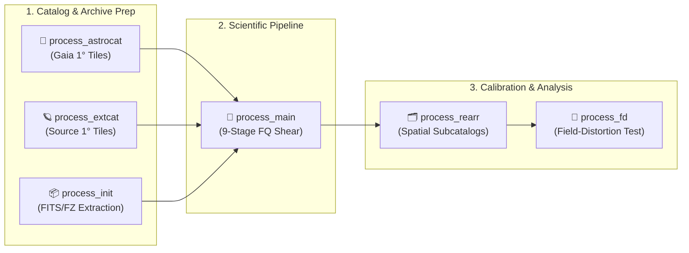

# 🌌 Fourier_Quad C++ Pipeline

An end-to-end, MPI-parallel **C++17** implementation of the **Fourier_Quad (FQ)** weak gravitational lensing shear measurement pipeline for wide-field CCD surveys (such as DECam). Starting from raw multi-extension FITS/FZ archives and reference catalogs, the unified `Fourier_Quad_Pipe` executable performs catalog tiling, exposure initialization, 9-stage Fourier-space PSF modeling and shear estimation, spatial subcatalog partitioning, and non-parametric Field-Distortion (FD) calibration.

---

## ✨ Key Features

- 🔬 **Rigorous Fourier-Space Shear Estimation** — Implements the **Fourier_Quad** method directly on 2D galaxy power spectra, performing exact PSF deconvolution in wavenumber space without restrictive morphological assumptions, while analytically correcting background and Poisson noise biases.
- ⚡ **End-to-End MPI Parallel Architecture** — Consolidates catalog preparation (`process_astrocat`, `process_extcat`), exposure extraction (`process_init`), 9-stage scientific measurement (`process_main`), spatial partitioning (`process_rearr`), and field-distortion shear recovery (`process_fd`) into a single distributed executable (`Fourier_Quad_Pipe`).
- 🧩 **Dual Source Variants (`Standard` & `Lite`)** — Ships with both a full-featured research tree ([`cpp_Standard/`](cpp_Standard/)) supporting multi-scale PCA PSF reconstruction, hybrid PSF models, and super-flat calibration, and a streamlined production tree ([`cpp_Lite/`](cpp_Lite/)) with unused branches physically removed at compile time.
- 🛠️ **Layered Compile-Time & INI Configuration** — Combines zero-overhead `constexpr` header defaults (`config/*.hpp`) with transactional runtime `--config pipeline.ini` overrides, ensuring reproducible survey runs without unnecessary recompilation.
- 📦 **Workstation & HPC Container Readiness** — Runs natively on Linux/HPC clusters or inside reproducible **Docker** (`fqctl.py`) and **Slurm + Apptainer** (`runner/run.sh`) containers with automated host-to-container path management.

---

## 🧭 Documentation Index

| Section | Guide & Target Link | Description |
| :--- | :--- | :--- |
| 🖥️ **Environment** | [Environment & Dependencies](CPP_GUIDE.md#environment-and-dependencies) | Native Linux/HPC compiler prerequisites, library versions (`CFITSIO`, `FFTW3`, `Eigen3`, `BLAS/LAPACK`), and variant selection (`Standard` vs. `Lite`). |
| 🗂️ **Data Preparation** | [Data Preparation Guide](DATA_PREPARATION.md) | Input specifications for Science/DQ FITS archives, Gaia astrometric tiles (Type 1 & Type 2), and external source catalogs. |
| ⚙️ **Configuration** | [INI Configuration](CPP_GUIDE.md#configuration) · [Parameter Reference](CPP_PIPELINE_PARAMETERS.md) | Runtime `--config` INI syntax, phase/stage switches, and the complete reference for all header constants and INI mappings. |
| 🚀 **Build & Run** | [Build & Execution Guide](CPP_GUIDE.md#build-and-run) | Native `make -j4` compilation, `mpirun` execution, 6-phase workflow scheduling, 9-stage prime bitmask, and common run recipes. |
| 🐳 **Docker Usage** | [Docker Workstation Guide](DOCKER.md) · [Container Paths](PATHS.md) | One-command containerized workflow (`python3 cpp_docker/fqctl.py`) and JSON mount/path mapping rules. |
| 🏔️ **HPC Runner** | [HPC Apptainer Guide](HPC.md) | Multi-node Slurm + PMI2 execution via Apptainer/Singularity (`cpp_docker/runner/run.sh`) on supercomputing clusters. |

> [!TIP]
> **AI Coding Assistant Integration:** An optional [Codex / Claude Code Manual](https://github.com/Syoong-s/FQNeoAIManual) is maintained separately to help AI agents configure environments, switch parameters, and operate this pipeline.

---

## 📚 Citations & References

This pipeline is the official C++ implementation of the **Fourier_Quad** weak-lensing framework. If you use this software or its scientific products in your research, please cite the following foundational papers:

1. **Foundational Fourier_Quad Method:**
   > **Zhang, J.** (2008), *"Measuring the cosmic shear in Fourier space"*, **Monthly Notices of the Royal Astronomical Society (MNRAS)**, 383(1), 113–118.
   > DOI: [10.1111/j.1365-2966.2007.12585.x](https://doi.org/10.1111/j.1365-2966.2007.12585.x) · arXiv: [astro-ph/0612146](https://arxiv.org/abs/astro-ph/0612146)

2. **Faint-Source Noise Correction & Power-Spectrum Formalism:**
   > **Zhang, J., Luo, W., & Foucaud, S.** (2015), *"Accurate Shear Measurement with Faint Sources"*, **Journal of Cosmology and Astroparticle Physics (JCAP)**, 2015(01), 024.
   > DOI: [10.1088/1475-7516/2015/01/024](https://doi.org/10.1088/1475-7516/2015/01/024) · arXiv: [1312.5514](https://arxiv.org/abs/1312.5514)

3. **PDF Symmetrization & Field-Distortion Shear Calibration:**
   > **Zhang, J., Dong, F., Li, H., et al.** (2019), *"Testing Shear Recovery with Field Distortion"*, **The Astrophysical Journal (ApJ)**, 875(1), 48.
   > DOI: [10.3847/1538-4357/ab1080](https://doi.org/10.3847/1538-4357/ab1080) · arXiv: [1808.02593](https://arxiv.org/abs/1808.02593)

---

## ⚖️ License & Versioning

- **Open-Source License:** Repository-authored source code, scripts, and documentation are distributed under the **[MIT License](LICENSE)** (`Copyright (c) 2026 Jun Zhang, Syoong-s`).
- **Third-Party Software:** Scientific libraries and container dependencies retain their respective upstream licenses; see **[Third-Party Notices](THIRD_PARTY_NOTICES.md)** for details.
- **Reproducibility:** For scientific analyses, always use a tagged [GitHub Release](https://github.com/Syoong-s/Fourier_Quad_Pipeline_Neo/releases) or fixed commit hash, and archive your `pipeline.ini` and any header modifications alongside your catalog outputs.
