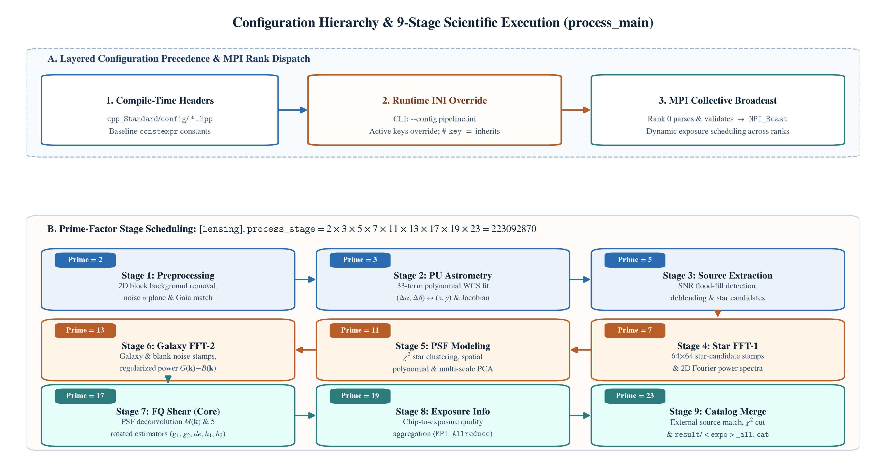

# 🛠️ C++ Pipeline User Guide

[🏠 Home](../README.md) · [🗂️ Data Preparation](DATA_PREPARATION.md) · [📋 Parameter Reference](CPP_PIPELINE_PARAMETERS.md) · [🐳 Docker](DOCKER.md) · [🏔️ HPC](HPC.md)

This guide covers **native Linux and HPC deployment** of `Fourier_Quad_Pipe` (`cpp_Standard/`), including environment prerequisites, INI configuration, compilation, MPI execution, and output inspection.

---

## Environment and Dependencies

### Required Toolchain & Scientific Libraries

| Dependency | Purpose | Reference Stack Version |
| :--- | :--- | :--- |
| **C++17 MPI Wrapper** (`mpicxx`) | Parallel C++17 compilation and MPI dispatch | GCC `12.3.0` + OpenMPI `4.1.8` |
| **CFITSIO** | Reading and writing FITS / `.fits.fz` images | `4.6.4` |
| **FFTW3** (`fftw3` & `fftw3f`) | Double- and single-precision Fast Fourier Transforms | `3.3.11` |
| **Eigen3** | Header-only linear algebra and matrix operations | `3.4.0` |
| **BLAS & LAPACK** | Dense numerical linear algebra and eigensolvers | OpenBLAS / Reference LAPACK |
| **GNU Make** | Build automation (`all` and `clean` targets) | `4.x+` |

### Supported Scientific Capabilities (`cpp_Standard/`)

| Capability | Configuration Key | Options & Behavior |
| :--- | :--- | :--- |
| **Astrometry Reference** | `[lensing].astrometry_trivial` / `astrometry_cat_type` | Gaia reference tiles (`0`, Type `1` $10^\circ$ or Type `2` $1^\circ$) or identity mapping (`1`). |
| **Super-Flat Correction** | `[lensing].include_flat` | Disabled (`0`, default) or apply super-flat calibration (`1`). |
| **DQ Mask Handling** | `[lensing].include_mask` | Configurable mask mode (`0..3`; default `2` per-chip DQ masks). |
| **Source Selection** | `[lensing].ext_cat` | External source catalog matching (`1`, default) or standalone detection (`0`). |
| **PSF Input & Model** | `[lensing].ext_psf` / `psf_type` | Exposure stars (`0`) or external PSF (`1`); local polynomial (`1`) or hybrid model (`2`). |
| **PCA PSF Reconstruction** | `[lensing].psf_ms` | Optional multi-scale PCA residual reconstruction (`1`; default `0`). |
| **Source Deblending** | `[lensing].deblending` | Enabled (`1`, default) or disabled (`0`). |
| **Default Enabled Phases** | `[process].run_process_*` | `init`, `main`, `rearr`, and `fd` enabled by default (`astrocat` and `extcat` off). |

> [!TIP]
> If you prefer not to build the C++ scientific stack on your host machine, use the prebuilt toolchain container via [Docker](DOCKER.md) or [HPC Apptainer](HPC.md).

---

## Configuration

The pipeline uses a **two-layer configuration architecture** that separates compile-time constants (`cpp_Standard/config/*.hpp`) from runtime INI overrides (`--config pipeline.ini`):



### Setting Up `pipeline.ini`

Copy the annotated template inside `cpp_Standard/`:

```bash
cd cpp_Standard
cp pipeline.example.ini pipeline.ini
```

> [!WARNING]
> `pipeline.example.ini` contains **commented blank entries** (`# key =`), not a ready-to-run survey setup. Commented keys retain the compiled header defaults (including original site-specific paths and default enabled phases). Always uncomment and populate your paths, datasets, and active phases before launching.

| INI Section | Scope | Key Responsibilities |
| :--- | :--- | :--- |
| `[process]` | Workflow Control | Top-level phase switches (`run_process_*`), explicit `expo_list`, and `rearr`/`fd` output paths. |
| `[astrocat]` | Gaia Tiling | Raw Gaia directory, output tile directory, header handling, and overwrite policy. |
| `[extcat]` | Source Tiling | Raw external catalog directory, 1-based column indices, magnitude mapping, and chunk size. |
| `[init]` | Archive Extraction | Science/DQ archive roots, `output_root`, `datasets` (`TARGET:PREFIX`), `contains` filters, and rerun policy. |
| `[lensing]` | Shear Pipeline | Prime stage selector (`process_stage`), camera geometry (`pixel_size`, `chipnx`, `chipny`), and catalog paths. |

### INI Syntax Rules: Omitted vs. Empty

```ini
[lensing]
# pixel_size =                  # Commented: retains compiled header value (0.2628).
pixel_size = 0.2628             # Active: explicitly overrides runtime value.
```

| INI Entry State | Runtime Behavior |
| :--- | :--- |
| **Omitted or commented (`# key =`)** | Retains the compiled default from `config/*.hpp`. |
| **Active empty string (`key =`)** | Clears a string setting (enabling downstream path derivation where supported). |
| **Active empty number or boolean** | Rejected with a configuration error (does not fall back to defaults). |
| **Active empty list** | Clears token/dataset filters; column projection lists must remain non-empty. |

- **Quoting & Comments:** Wrap paths containing `#`, `;`, or commas in quotes (`"..."`); unquoted `#` or `;` starts an inline comment.
- **Booleans:** Accept `true`/`false`, `1`/`0`, `yes`/`no`, and `on`/`off` (case-insensitive).
- **Compile-Time Only Parameters:** Settings marked `INI override: No` in the [Parameter Reference](CPP_PIPELINE_PARAMETERS.md) must be edited in `cpp_Standard/config/*.hpp` followed by `make clean && make -j4`.

---

## Build and Run

### 1. Compile the Executable

Build directly with `make` when libraries are on standard system paths, or pass path overrides:

```bash
cd cpp_Standard

# Standard system paths
make -j4

# Custom scientific stack prefix
make CXX=/path/to/mpicxx STACK_PREFIX=/opt/science-stack -j4

# Separate Eigen3 include path
make CXX=/path/to/mpicxx STACK_PREFIX=/opt/science-stack \
     EIGEN_INCLUDE=/opt/eigen/include/eigen3 -j4
```

| Make Variable | Default | Description |
| :--- | :--- | :--- |
| `CXX` | `mpicxx` | MPI C++17 compiler wrapper. |
| `STACK_PREFIX` | *(empty)* | Adds `<prefix>/include`, `<prefix>/include/eigen3`, and `<prefix>/lib`. |
| `EIGEN_INCLUDE` | *(empty)* | Explicit directory containing `Eigen/Dense`. |

> [!CAUTION]
> Always run `make clean` before rebuilding after modifying any `.hpp` header or switching compilers. Never run concurrent builds or clean operations in the same source directory while a job is executing.

### 2. Launch with MPI

Use at least **2 MPI ranks** for normal distributed processing:

```bash
mpirun -np 4 ./Fourier_Quad_Pipe --config /absolute/path/to/pipeline.ini
```

| Command-Line Invocation | Execution Behavior |
| :--- | :--- |
| `./Fourier_Quad_Pipe` | Uses compiled header defaults only (no automatic `pipeline.ini` lookup). |
| `./Fourier_Quad_Pipe --config file.ini` | Applies `file.ini` overrides on top of compiled defaults. |
| `./Fourier_Quad_Pipe --config=file.ini` | Equivalent single-argument syntax. |

*(All other application CLI flags are rejected; MPI launcher flags such as `mpirun -np` belong to the MPI runtime.)*

---

## Workflow Phases & Main Stages

### Top-Level Phase Execution Order

Catalog preparation phases (`astrocat`, `extcat`) execute once per run. Enabled dataset phases (`init`, `main`, `rearr`, `fd`) then execute sequentially for each configured `TARGET:PREFIX` dataset:

| Order | Phase Name | `[process]` Switch | Input | Primary Output |
| :---: | :--- | :--- | :--- | :--- |
| **1** | `process_astrocat` | `run_process_astrocat` | Raw 2-column Gaia files | Canonical $1^\circ \times 1^\circ$ Gaia tiles (`astra_*.dat`) |
| **2** | `process_extcat` | `run_process_extcat` | Raw external source catalogs | Canonical $1^\circ \times 1^\circ$ source tiles (`extern_*.dat`) |
| **3** | `process_init` | `run_process_init` | Science & DQ `.fits.fz` archives | Extracted CCD FITS tree + `expo_<target>.list` |
| **4** | `process_main` | `run_process_main` | Extracted CCDs + reference tiles | Per-exposure shear catalogs (`<exposure>_all.cat`) |
| **5** | `process_rearr` | `run_process_rearr` | Per-exposure shear catalogs | Spatially partitioned subcatalogs (`baked/subcat_*.cat`) |
| **6** | `process_fd` | `run_process_fd` | Spatial subcatalogs + metadata | Field-Distortion shear recovery (`fdout/FD_test_comb.dat`) |

### 9-Stage Scientific Pipeline (`process_main`)

Inside `process_main`, exposures are dynamically load-balanced across MPI ranks while chips within each exposure are processed sequentially. Active stages are controlled via **prime factor decomposition** in `[lensing].process_stage` (as illustrated in Panel B of the figure above):

| Stage | Prime Factor | Core Function |
| :---: | :---: | :--- |
| **1** | `2` | Background/noise preprocessing and Gaia matching |
| **2** | `3` | PU polynomial astrometric solution |
| **3** | `5` | Source detection, deblending, and star-candidate identification |
| **4** | `7` | Star-candidate 2D Fourier power spectra |
| **5** | `11` | PSF star selection ($\chi^2$ clustering) and spatial polynomial / PCA modeling |
| **6** | `13` | Galaxy 2D Fourier power spectra and noise subtraction |
| **7** | `17` | Fourier_Quad deconvolution, 5 shear estimators ($g_1, g_2, de, h_1, h_2$), and morphology |
| **8** | `19` | Exposure-level diagnostics aggregation (`MPI_Allreduce`) |
| **9** | `23` | Catalog combination, quality cuts, and field-distortion calibration |

- **Full 9-Stage Product:** `2 * 3 * 5 * 7 * 11 * 13 * 17 * 19 * 23 = 223092870` (default).
- **Partial Runs:** Multiply only the primes of the stages you wish to execute (prerequisite stage products must already exist on disk; **Stage 9 (`23`) strictly requires Stage 8 (`19`)**).

---

## Common Run Recipes

Merge the relevant snippet below into your `pipeline.ini` and launch with `mpirun -np 4 ./Fourier_Quad_Pipe --config /path/to/pipeline.ini`.

<details>
<summary><b>Recipe 1: Prepare Gaia & External Source Tiles Only</b></summary>

```ini
[process]
run_process_astrocat = true
run_process_extcat   = true
run_process_init     = false
run_process_main     = false
run_process_rearr    = false
run_process_fd       = false

[astrocat]
input_directory  = /data/gaia/raw
output_directory = /data/gaia/tiles
add_header       = true
existing_policy  = fail

[extcat]
input_directory  = /data/sources/raw
output_directory = /data/sources/tiles
```

> Match `[lensing].astrometry_cat` (with `[lensing].astrometry_cat_type = 2`) and `[lensing].source_cat` to these output directories in subsequent measurement runs.
</details>

<details>
<summary><b>Recipe 2: Initialize Science/DQ Archives Only</b></summary>

```ini
[process]
run_process_astrocat = false
run_process_extcat   = false
run_process_init     = true
run_process_main     = false
run_process_rearr    = false
run_process_fd       = false

[init]
science_root = /data/archive/science
dq_root      = /data/archive/dq
output_root  = /data/work
datasets     = g2019:c4d_19
contains     = v1
existing     = fail             # fail | resume | overwrite
```
</details>

<details>
<summary><b>Recipe 3: Run Main Shear Measurement on an Existing Exposure List</b></summary>

```ini
[process]
run_process_astrocat = false
run_process_extcat   = false
run_process_init     = false
run_process_main     = true
run_process_rearr    = false
run_process_fd       = false
expo_list            = /data/work/expo_g2019.list

[init]
datasets = g2019:c4d_19

[lensing]
astrometry_cat = /data/gaia/tiles
source_cat     = /data/sources/tiles
process_stage  = 223092870
```
</details>

---

## Output Directory Structure & Products

```text
<output_root>/
├── expo_<target>.list                  # Top-level exposure list (per-exposure chip lists)
├── fits_<target>.list                  # Extracted Science FITS manifest
└── <target>/                           # Dataset root (e.g., g2019/)
    ├── science/                        # Extracted per-CCD Science FITS
    ├── dqmask/                         # Extracted per-CCD DQ mask FITS
    ├── expolists/                      # Per-exposure chip lists
    ├── astrometry/                     # WCS headers and astrometric residuals
    ├── stamps/                         # Intermediate stamps, power spectra, PSF models
    ├── result/
    │   └── <exposure>_all.cat          # Per-exposure combined shear catalog (49 cols default)
    ├── baked/
    │   └── subcat_*.cat                # Spatially partitioned subcatalogs (process_rearr)
    └── fdout/
        └── FD_test_comb.dat            # Field-distortion calibration table (process_fd)
```

- **Catalog Width:** By default (`ext_cat = 1` with 18 external columns), `<exposure>_all.cat` has **49 columns**: `18` external source fields + `EXPO_NUM` + `ccD_NUM` + `28` Stage-7 shear/morphology fields + exposure `Chi2`. When `ext_cat = 0` (no external catalog), the output catalog has **31 columns**.

---

## Troubleshooting

| Symptom / Error | Cause & Resolution |
| :--- | :--- |
| **MPI compiler or library not found** | Check `CXX`, `STACK_PREFIX`, `EIGEN_INCLUDE`, and loaded `module` environment. |
| **Unknown CLI option** | Only `--config PATH` is accepted; move all phase/path options into `pipeline.ini`. |
| **Unknown INI key** | Verify section and key spelling against [CPP_PIPELINE_PARAMETERS.md](CPP_PIPELINE_PARAMETERS.md). |
| **Commented INI entry has no effect** | `# key =` retains compiled defaults; remove `#` and provide an explicit value. |
| **Missing Gaia or source tiles** | Check directory path, Type-1 vs. Type-2 naming (`astrometry_cat_type`), prefix, and sky footprint. |
| **Stage 9 (`23`) rejected** | Include Stage 8 (`19`) in `[lensing].process_stage`. |
| **Rerun refuses existing outputs** | Set `[init].existing` (or catalog `existing_policy`) to `resume` or `overwrite`. |
| **Outputs written to unexpected path** | Downstream phases derive dataset roots from the FITS paths inside `expo_<target>.list`, not solely from `[init].output_root`. |
